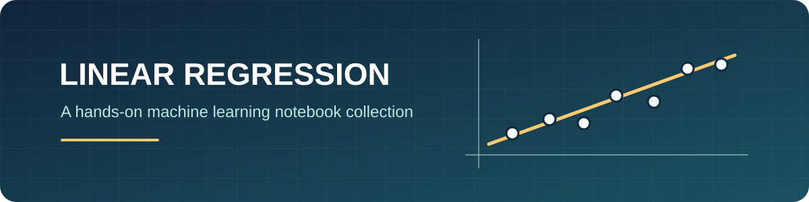

<p align="center">
  
</p>

# Linear Regression Lab

A collection of beginner-friendly Jupyter notebooks for exploring linear
regression with Python and scikit-learn. The exercises use small datasets to
practice preparing features, fitting models, making predictions, and checking
model performance.

## Projects

| Project | Notebook | Data | Prediction task |
| --- | --- | --- | --- |
| California housing | [`project1/`](./project1/) | [`house_price_prediction.ipynb`](./project1/house_price_prediction.ipynb) and [`california_housing_train.csv`](./project1/california_housing_train.csv) | Estimate median house value from housing, location, and income features |
| Car fuel efficiency | [`project2/`](./project2/) | [`car_fuel_efficency_prediction.ipynb`](./project2/car_fuel_efficency_prediction.ipynb) and [`car_fuel_efficiency_practice.csv`](./project2/car_fuel_efficiency_practice.csv) | Predict fuel efficiency in km/L from vehicle features |
| Energy efficiency | [`project3/`](./project3/) | [`energy_effciency_prediction.ipynb`](./project3/energy_effciency_prediction.ipynb) and [`ENB2012_data.xlsx`](./project3/ENB2012_data.xlsx) | Predict building heating load from energy-efficiency features |

Each project is self-contained. See the [California housing README](./project1/README.md),
the [car fuel efficiency README](./project2/README.md), and the
[energy efficiency README](./project3/README.md) for project-specific details.

## Requirements

- Python 3
- Jupyter Notebook or Visual Studio Code with the Jupyter extension
- pandas, NumPy, scikit-learn, Matplotlib, Seaborn, and openpyxl

Install the libraries from PowerShell:

```powershell
python -m pip install pandas numpy scikit-learn matplotlib seaborn openpyxl jupyter
```

## Run a notebook

Change to this `linear regression` folder, start Jupyter, and open one of the
top-level notebooks:

```powershell
cd "D:ml\linear regression"
jupyter notebook
```

For a notebook in `project1`, `project2`, or `project3`, start Jupyter from that
project folder instead. The notebooks load their datasets using relative paths,
so running them from the folder containing the corresponding data file keeps
the data paths working. In VS Code, open the relevant folder, choose a Python
kernel with the dependencies installed, and run the notebook cells from top to
bottom.

## Typical workflow

The notebooks demonstrate variations of this workflow:

1. Load a dataset with pandas and inspect its contents.
2. Select input features and a prediction target.
3. Split the rows into training and test sets.
4. Fit a scikit-learn linear regression model.
5. Generate predictions and evaluate them with metrics or plots.

These are learning exercises. Model results depend on the provided datasets
and should not be treated as guaranteed real-world predictions.
